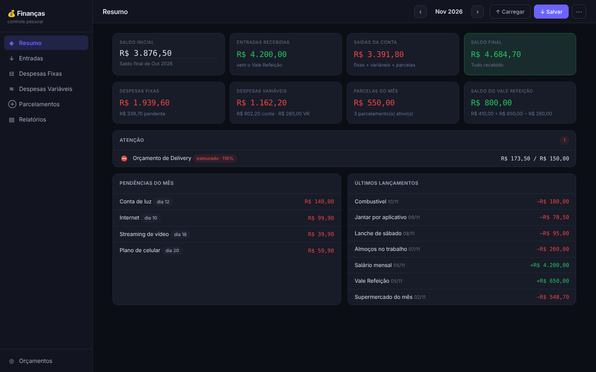
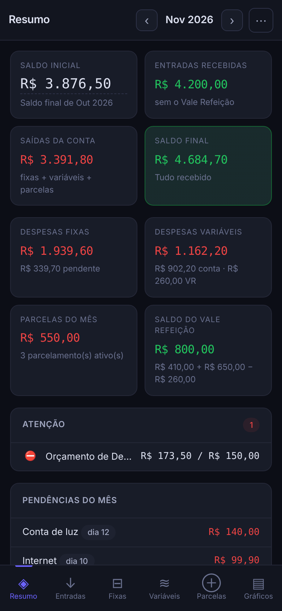
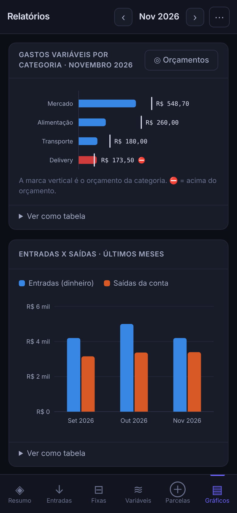
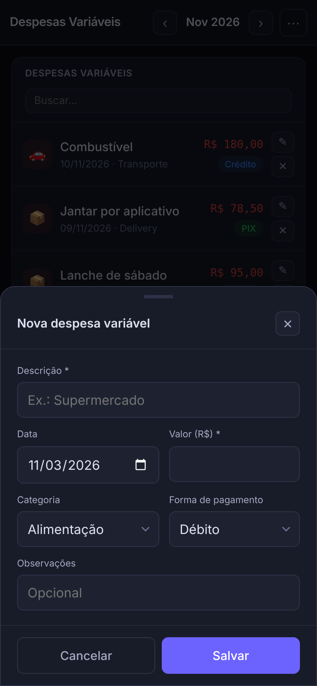

# 💰 Personal Finance Tracker (Controle Financeiro)

[🇧🇷 Português](README.md) | 🇺🇸 English

A personal finance tracker built with **plain HTML, CSS and JavaScript**: no frameworks, no libraries and no build step. Record income, fixed and variable expenses and installment purchases month by month, follow budgets per category and see everything in charts.

The same `index.html` works on **desktop** and **mobile**: the layout adapts to the screen and the app can be **installed as a PWA** that works offline. Data stays in the browser only (`localStorage`) and can be saved and loaded as JSON or exported as CSV.

> Part of my **AI-assisted development** portfolio. See how it was built in [`docs/AI-WORKFLOW.md`](docs/AI-WORKFLOW.md).

> ℹ️ The app interface is in Brazilian Portuguese and amounts are shown in Brazilian reais (R$).



<p align="center">
  
  
  
</p>

---

## ✨ Features

### Monthly summary
- **Automatic opening balance:** carried over from the previous month's closing balance and always recalculated, so fixing a past month updates the following ones. You can also type a manual value and go back to automatic with one click.
- Cards for income received, money out of the account, **closing balance** and **projected balance** (counting income still to come).
- **Meal voucher balance kept separate** from the bank account: the meal voucher (*Vale Refeição*, a common Brazilian employee benefit) and expenses paid with it never mix with cash.
- **Attention** panel with overdue bills, bills due today or in the next 3 days, and budgets close to or over the limit.
- Pending items for the month and latest entries.

### Entries
| Section | What it records |
|---|---|
| **Income** | Salary, meal voucher, freelance and others, with *Received / To receive* status |
| **Fixed expenses** | Monthly bills with due day, payment method and *Paid / Pending* status |
| **Variable expenses** | Day-to-day spending by category and payment method (including meal voucher) |
| **Installments** | Installment purchases with progress (`3/10`), calculated installment value and remaining balance |

- **Search** in every list (case- and accent-insensitive).
- Click the status to toggle it (received, paid, active).
- Validated forms, so nothing is saved without a description or with a zero amount.

### Month rollover
When moving to a new month, the app asks for confirmation and:
- copies the **fixed expenses** (as pending) and the **recurring income** (salary and meal voucher, as *to receive*, dated +1 month);
- advances **+1 installment** on every active installment purchase. The last installment is charged in its own month, and the purchase leaves the list the following month.

### Budgets and reports
- **Monthly budget per variable-expense category**, with progress bars and a warning from 80% on.
- **Hand-made SVG charts**, no library: spending by category with the budget mark, income × expenses over the last 6 months and closing balance per month. They have tooltips and a **"View as table"** option.

### Data
- **Save backup (JSON)** and **Load backup**. Import validates the file, shows how many months and entries exist now and in the file, and asks for confirmation before replacing.
- **Export month to CSV** (`;` separator and decimal comma, opens directly in Excel set to Portuguese).
- Fictitious **sample data** to explore the app, and **Delete all data**.
- Opens backups from the previous version (v1) and converts them automatically.

---

## 🚀 Getting started

1. Download or clone the repository:
   ```bash
   git clone https://github.com/<your-username>/<repository-name>.git
   ```
2. Open `index.html` in a modern browser (Chrome, Edge, Firefox or Safari).
3. The first time, choose **Começar do zero** (start from scratch) or **Ver com dados de exemplo** (view with sample data).

There is nothing to install. To use it as a **mobile app** (PWA, offline), publish it on **GitHub Pages** (Settings → Pages → branch `main`) and use *Add to Home Screen* on your phone. Offline mode needs the site served over `https://`; opening the file directly (`file://`) everything works except installation.

> 🔒 **Privacy:** no data ever leaves your browser. There is no server, account or tracking. Each browser keeps its own data, so use the JSON backup to move from desktop to phone.

---

## 🧪 Tests

The business rules live in a pure module (`src/finance.js`) that runs both in the browser and in Node. The Jest tests check exactly the code the interface uses.

```bash
npm install
npm test              # 73 tests
npm run test:coverage # coverage (~97% of src/finance.js)
```

| File | What it covers |
|---|---|
| `datas.test.js` | Month keys, date advancing (Jan 31 → Feb 28, leap years), R$ formatting |
| `virada-de-mes.test.js` | Copying fixed and recurring entries; a 3× installment is charged exactly 3 times |
| `saldo.test.js` | Balance, separate meal voucher, chained automatic balance, editing a past month, 20 years of months |
| `orcamento-e-alertas.test.js` | Budget levels, due dates (including day 31 in a 30-day month), accent-free search |
| `importacao-e-seguranca.test.js` | HTML escaping, backup validation and migration, CSV with formula-injection protection |
| `dados-exemplo.test.js` | Deterministic, valid sample data with no real brands |

Tests run on GitHub Actions on every push (`.github/workflows/tests.yml`).

---

## 🗂️ Structure

```
├── index.html              # single page (responsive layout)
├── styles.css              # dark theme; desktop ≥ 900px, mobile below that
├── src/
│   ├── finance.js          # pure business rules (tested)
│   └── app.js              # UI: rendering, forms, charts, events
├── manifest.webmanifest    # PWA
├── sw.js                   # service worker (offline cache of the app files)
├── icons/                  # app icons
├── exemplo-dados.json      # sample backup with fictitious data (can be imported)
├── scripts/gerar-exemplo.js
├── tests/                  # Jest tests
└── docs/
    ├── AI-WORKFLOW.md      # how the project was built with AI
    └── screenshots/
```

## 🛠️ Tech stack

- HTML5, CSS3 (Grid, Flexbox, media queries, `env(safe-area-inset-*)`) and ES2020 JavaScript, with no production dependencies
- SVG generated in JS for the charts
- `localStorage`, `Blob`/`FileReader` for backups, Service Worker and Web App Manifest
- Jest (tests only) and GitHub Actions

## 🗺️ Roadmap

- Custom recurring entries (beyond salary and meal voucher)
- Light theme
- Optional sync between devices

## 📄 License

[MIT](LICENSE)
