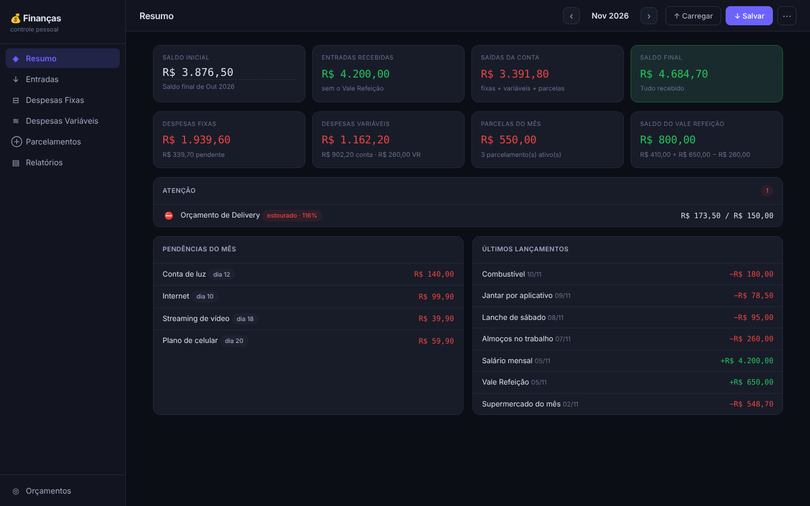
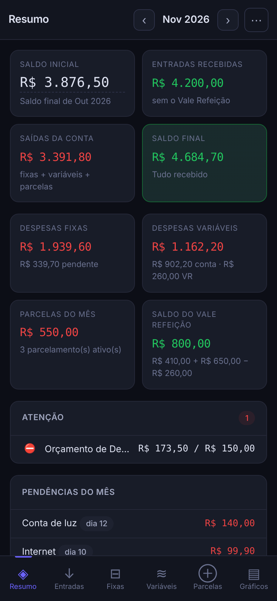
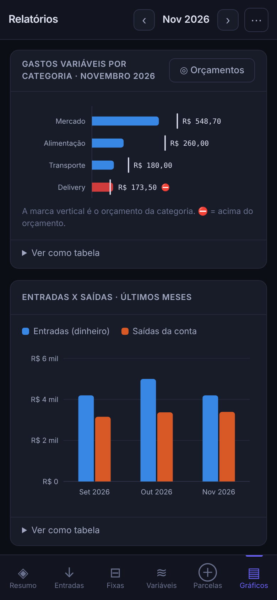
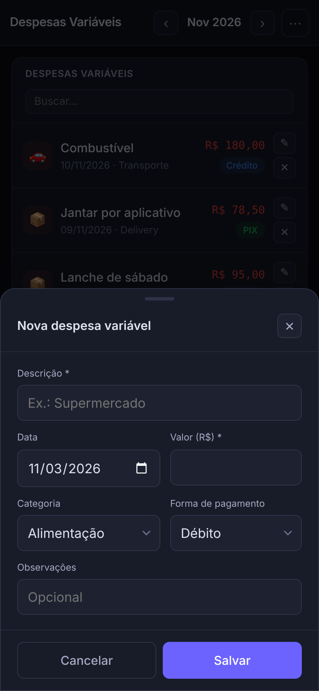

# 💰 Controle Financeiro

🇧🇷 Português | [🇺🇸 English](README.en.md)

Controle financeiro pessoal feito com **HTML, CSS e JavaScript puros**, sem frameworks, sem bibliotecas e sem build. Registre entradas, despesas fixas e variáveis e parcelamentos mês a mês, acompanhe orçamentos por categoria e veja tudo em gráficos.

O mesmo `index.html` funciona no **computador** e no **celular**: o layout se adapta à tela e o app pode ser **instalado como PWA**, funcionando offline. Os dados ficam só no navegador (`localStorage`) e podem ser salvos e carregados em JSON ou exportados em CSV.

> Projeto do meu portfólio de **desenvolvimento com IA**. Veja como ele foi feito em [`docs/AI-WORKFLOW.md`](docs/AI-WORKFLOW.md).



<p align="center">
  
  
  
</p>

---

## ✨ Funcionalidades

### Resumo do mês
- **Saldo inicial automático:** vem do saldo final do mês anterior e é recalculado sempre, então corrigir um mês passado atualiza os seguintes. Também dá para digitar um valor manual e voltar ao automático com um clique.
- Cards com entradas recebidas, saídas da conta, **saldo final** e **saldo previsto** (contando o que falta receber).
- **Saldo do Vale Refeição separado** da conta: o VR recebido e os gastos pagos com VR não se misturam com o dinheiro.
- Painel **Atenção** com contas atrasadas, que vencem hoje ou nos próximos 3 dias, e orçamentos perto do limite ou estourados.
- Pendências do mês e últimos lançamentos.

### Lançamentos
| Seção | O que registra |
|---|---|
| **Entradas** | Salário, Vale Refeição, freelance e outros, com status *Recebido / A receber* |
| **Despesas fixas** | Contas mensais com dia de vencimento, forma de pagamento e status *Pago / Pendente* |
| **Despesas variáveis** | Gastos do dia a dia por categoria e forma de pagamento (inclusive VR) |
| **Parcelamentos** | Compras parceladas com progresso (`3/10`), valor da parcela calculado e saldo a pagar |

- **Busca** em cada lista (ignora maiúsculas e acentos).
- Clique no status para alternar (recebido, pago, ativo).
- Formulários com validação, para não salvar item sem descrição ou com valor zero.

### Virada de mês
Ao avançar para um mês novo, o app pede confirmação e:
- copia as **despesas fixas** (como pendentes) e as **entradas recorrentes** (Salário e VR, como *a receber*, com a data +1 mês);
- avança **+1 parcela** em cada parcelamento ativo. A última parcela é cobrada no mês dela, e o parcelamento sai da lista no mês seguinte.

### Orçamentos e relatórios
- **Orçamento mensal por categoria** de despesa variável, com barras de progresso e alerta a partir de 80%.
- **Gráficos em SVG feitos à mão**, sem biblioteca: gastos por categoria com a marca do orçamento, entradas × saídas dos últimos 6 meses e saldo final por mês. Têm tooltip e a opção **"Ver como tabela"**.

### Dados
- **Salvar backup (JSON)** e **Carregar backup**. A importação valida o arquivo, mostra quantos meses e lançamentos existem agora e no arquivo, e pede confirmação antes de substituir.
- **Exportar mês em CSV** (separador `;` e vírgula decimal, abre direto no Excel em português).
- **Dados de exemplo** fictícios para conhecer o app, e **Apagar todos os dados**.
- Abre os backups da versão anterior (v1) e converte automaticamente.

---

## 🚀 Como usar

1. Baixe ou clone o repositório:
   ```bash
   git clone https://github.com/<seu-usuario>/<nome-do-repositorio>.git
   ```
2. Abra o `index.html` em um navegador moderno (Chrome, Edge, Firefox ou Safari).
3. Na primeira vez, escolha **Começar do zero** ou **Ver com dados de exemplo**.

Não há nada para instalar. Para usar como **app no celular** (PWA, offline), publique no **GitHub Pages** (Settings → Pages → branch `main`) e, no celular, use *Adicionar à tela inicial*. O modo offline precisa do site em `https://`; abrindo o arquivo direto (`file://`), tudo funciona, menos a instalação.

> 🔒 **Privacidade:** nenhum dado sai do seu navegador. Não há servidor, conta ou rastreamento. Os dados de cada navegador ficam separados, então use o backup em JSON para passar do computador para o celular.

---

## 🧪 Testes

As regras de negócio ficam em um módulo puro (`src/finance.js`), que roda no navegador e no Node. Os testes Jest verificam exatamente o código que a interface usa.

```bash
npm install
npm test              # 73 testes
npm run test:coverage # cobertura (~97% de src/finance.js)
```

| Arquivo | O que cobre |
|---|---|
| `datas.test.js` | Chaves de mês, avanço de datas (31/01 → 28/02, ano bissexto), formatação em R$ |
| `virada-de-mes.test.js` | Cópia de fixas e recorrentes; um parcelamento 3× é cobrado exatamente 3 vezes |
| `saldo.test.js` | Saldo, VR separado, saldo automático em cadeia, edição de mês passado, 20 anos de meses |
| `orcamento-e-alertas.test.js` | Níveis de orçamento, vencimentos (inclusive dia 31 em mês de 30), busca sem acento |
| `importacao-e-seguranca.test.js` | Escape de HTML, validação e migração de backups, CSV com proteção contra fórmulas |
| `dados-exemplo.test.js` | Dados de exemplo determinísticos, válidos e sem marcas reais |

Os testes rodam no GitHub Actions a cada push (`.github/workflows/tests.yml`).

---

## 🗂️ Estrutura

```
├── index.html              # página única (layout responsivo)
├── styles.css              # tema escuro; computador ≥ 900px, celular abaixo disso
├── src/
│   ├── finance.js          # regras de negócio puras (testadas)
│   └── app.js              # interface: renderização, formulários, gráficos, eventos
├── manifest.webmanifest    # PWA
├── sw.js                   # service worker (cache offline dos arquivos do app)
├── icons/                  # ícones do app
├── exemplo-dados.json      # backup de exemplo com dados fictícios (pode ser importado)
├── scripts/gerar-exemplo.js
├── tests/                  # testes Jest
└── docs/
    ├── AI-WORKFLOW.md      # como o projeto foi feito com IA
    └── screenshots/
```

## 🛠️ Tecnologias

- HTML5, CSS3 (Grid, Flexbox, media queries, `env(safe-area-inset-*)`) e JavaScript ES2020, sem dependências em produção
- SVG gerado em JS para os gráficos
- `localStorage`, `Blob`/`FileReader` para backup, Service Worker e Web App Manifest
- Jest (só para os testes) e GitHub Actions

## 🗺️ Próximos passos

- Lançamentos recorrentes personalizados (além de Salário e VR)
- Tema claro
- Sincronização opcional entre dispositivos

## 📄 Licença

[MIT](LICENSE)
